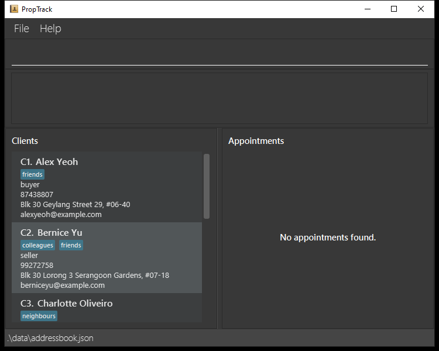
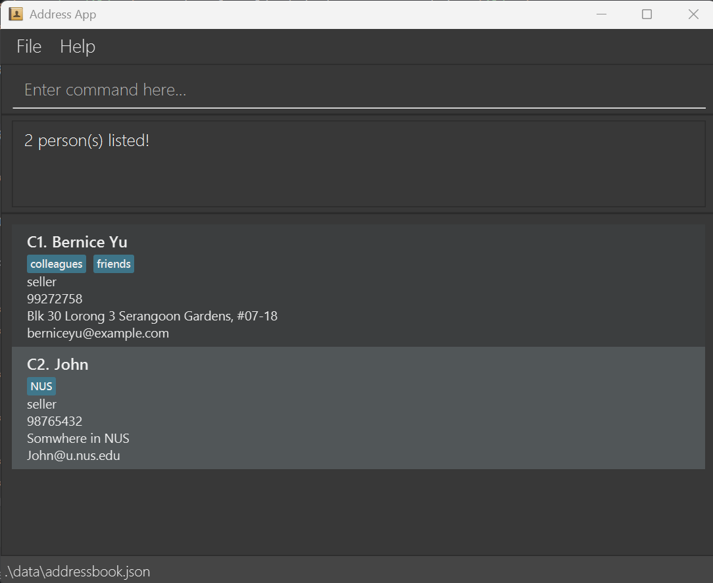
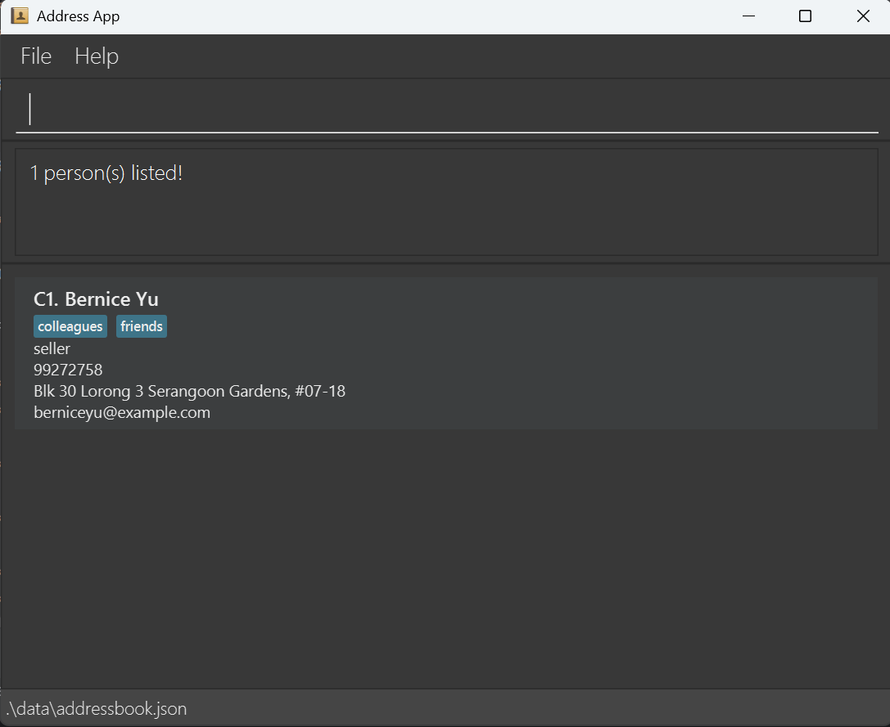
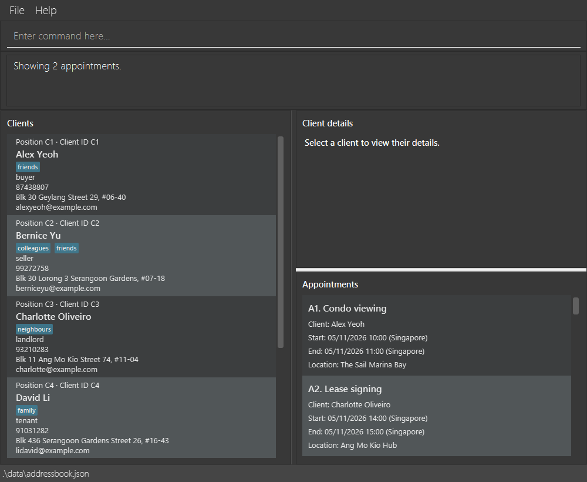

PropTrack is a **desktop client directory for insurance and property agents, optimized for use through a Command Line Interface (CLI)** while retaining the benefits of a Graphical User Interface (GUI). It helps agents add, find and update client contact details quickly, reducing the time spent on contact administration. If you type quickly, PropTrack can help you manage your clients faster than traditional GUI applications.

* Table of Contents
{:toc}

--------------------------------------------------------------------------------------------------------------------

## Quick start

1. Ensure that Java `25` or later is installed on your computer. 
   **Mac users:** Ensure you have the precise JDK version prescribed [here](https://se-education.org/guides/tutorials/javaInstallationMac.html).

1. Download the latest `.jar` file from [here](https://github.com/AY2627S1-CS2103-F11-2/tp/releases).

1. Copy the file to the folder you want to use as the _home folder_ for PropTrack.

1. Open a terminal, `cd` to the folder containing the JAR file, and run `java -jar proptrack.jar`. 
   A GUI similar to the one below should appear in a few seconds. Note how the app contains some sample data. 
   

1. Type a command in the command box and press Enter to execute it. For example, type **`help`** and press Enter to open the help window. 
   Some example commands you can try:

   * `list` : Lists all clients.

   * `add n/John Doe p/98765432 a/John street, block 123, #01-01 y/buyer` : Adds a client named `John Doe` without an email address.

   * `delete C3` : Deletes the 3rd client shown in the current list.

   * `clear` : Deletes all clients.

   * `exit` : Exits the app.

1. Refer to the [Features](#features) section below for details of each command.

--------------------------------------------------------------------------------------------------------------------

## Features

**:information_source: Notes about the command format:** 

* Words in `UPPER_CASE` are the parameters to be supplied by the user. 
  For example, in `add n/NAME`, replace `NAME` with a value such as `John Doe`.

* Items in square brackets are optional. 
  For example, `n/NAME [t/TAG]` can be used as `n/John Doe t/friend` or as `n/John Doe`.

* Items followed by `…`​ can appear zero or more times. 
  For example, `[t/TAG]…​` may be omitted, or written as `t/friend` or `t/friend t/family`.

* Parameters can be in any order. 
  For example, if the command specifies `n/NAME p/PHONE_NUMBER`, `p/PHONE_NUMBER n/NAME` is also acceptable.

* Extraneous parameters for commands that take no parameters, such as `help`, `list`, `exit`, and `clear`, are ignored. 
  For example, `help 123` is interpreted as `help`.

* If you are using a PDF version of this document, be careful when copying and pasting commands that span multiple lines as space characters surrounding line-breaks may be omitted when copied over to the application.

### Viewing help: `help`

Shows a message explaining how to access the help page.

Format: `help`

### Adding a client: `add`

Adds a client to PropTrack and assigns a permanent client ID such as `C1`.

Format: `add n/NAME p/PHONE_NUMBER a/ADDRESS y/TYPE [e/EMAIL] [t/TAG]…​`

* `NAME` must contain 1–100 printable characters and at least one Unicode letter or digit.
  Punctuation is allowed, including apostrophes and hyphens.
* Leading and trailing spaces are removed, and repeated spaces are collapsed to one space.
  Letter case is preserved. For example, `n/  Anne-Marie   O'Connor  ` is stored as `Anne-Marie O'Connor`.
* The length limit applies after spaces are normalized. Unicode characters, including supplementary characters,
  each count as one character.
* Blank, punctuation-only, non-printable and overlong names are rejected with
  `Name must contain 1-100 characters and at least one letter or digit.` No client is added.
* `TYPE` must be `buyer`, `seller`, `landlord` or `tenant`, in lowercase.
* Email is optional. Omit the entire `e/EMAIL` field if the client's email is unknown.
  The client card and details panel show `Not provided`, and the email remains absent after saving and reopening the app.
* If `e/` is supplied when adding a client, it must contain a valid email address. A bare `e/`,
  whitespace-only email or malformed address is rejected. Repeating `e/` is also rejected.
* On success, the result identifies the new client and its current command position, for example
  `Added client C8: Alex Tan. Current position: C1 (for delete/appointment commands).`
  The full client list is shown, sorted alphabetically by name without regard to letter case, then by numeric
  client ID when names compare equally. The new client is selected automatically and their details appear in the details panel.
* If the name already belongs to a client, no client is added. The result identifies the existing record,
  for example `Name already belongs to client C1 (Alex Tan). No client was added.`
* A client's ID is saved with the record and remains unchanged when the list is sorted or filtered,
  when other clients are deleted, when the client is edited, and after reopening the app.
  Each card labels these separately, for example `Position C1 · Client ID C8`.
  The position may change as the displayed list changes; the **Client ID** identifies the saved record
  and is also shown in the details panel. It is separate from the positional
  references accepted by `delete`, `appointment` and `appointments`: those commands still use `C` followed
  by the current row number. For example, a client with permanent ID `C8` in row `1` is addressed as `C1`
  by those commands, or as `1` by `edit`. The success message reports the position immediately after
  the addition; check the current card position again after later sorting, filtering or other list changes.

:bulb: **Tip:**
A client can have any number of tags, including zero.

Examples:
* `add n/John Doe p/98765432 e/johnd@example.com a/John street, block 123, #01-01 y/buyer`
* `add n/Alex Tan p/91234567 a/123 Clementi Road y/buyer` adds a client whose email is not yet known.
* `add n/Anne-Marie O'Connor p/91234567 e/anne@example.com a/123 Clementi Road y/seller`
* `add n/张伟 p/92345678 e/zhang@example.com a/456 Tampines Road y/tenant t/friend`

### Listing all clients: `list`

Shows every client in PropTrack and clears any active filter. Clients are sorted alphabetically by name,
ignoring letter case, then by numeric client ID. Position references start from `C1`; permanent Client IDs do not change.

Format: `list`

* The result box reports how many clients are shown, for example `Listed 14 clients`.
* Anything typed after `list` is ignored, so `list now` behaves the same as `list`.

### Editing a client: `edit`

Edits an existing client in PropTrack.

Format: `edit INDEX [n/NAME] [p/PHONE] [e/EMAIL] [a/ADDRESS] [y/TYPE] [t/TAG]…​`

* Edits the client at the specified `INDEX`. Use the numeric part of the card's `Position` label,
  **not** its permanent Client ID. For example, `Position C1` means index `1`. The index **must be a positive integer** 1, 2, 3, …​
  For example, `edit 1 n/Alice` edits the first visible row even if the Client ID in their details is `C8`.
  Editing retains the client's stable ID; changing the name may move the card in the alphabetically sorted list.
* At least one of the optional fields must be provided.
* Existing values will be updated to the input values.
* Edited names follow the same validation and space normalization rules as [adding a client](#adding-a-client-add).
* If `y/TYPE` is supplied, it must be `buyer`, `seller`, `landlord` or `tenant`, in lowercase.
* Omit `e/EMAIL` to retain the client's current email. To clear an existing email, supply a bare `e/`;
  the client card and command feedback then show `Not provided`.
* When editing tags, all of the client's existing tags are removed; adding tags is not cumulative.
* To remove all of a client's tags, enter `t/` without a tag after it.

Examples:
*  `edit 1 p/91234567 e/johndoe@example.com` Edits the phone number and email address of the 1st client to be `91234567` and `johndoe@example.com` respectively.
*  `edit 2 n/Betsy Crower t/` Edits the name of the 2nd client to be `Betsy Crower` and clears all existing tags.
*  `edit 1 e/` Clears the email address of the 1st client.

### Searching for clients: `search`

Finds clients whose names contain any of the given keywords.

Format: `search [n/NAME] [p/PHONE_NUMBER] [y/TYPE]`

* `n/` specifies the name to search for. The search is case-insensitive and matches full words in the client's name
* `p/` specifies the phone number to search for. The phone number must match exactly
* `y/` specifies the client type to search for. Valid types are `buyer`, `seller`, `tenant` and `landlord`, **in lowercase ONLY**
* Search requires at least one parameter and supports any combination of name, phone number, and client type parameters, including all three
* The search returns a list of clients who match the specified search criteria

Examples:
* `search n/John` returns `John` and `John Doe`
* `search p/98765432` returns clients with the phone number `98765432`
* `search y/seller` returns a list of clients whose client type is `seller` 
* `search n/Alice` searches for clients whose name contains `Alice`. 
* `search n/John p/98765432 y/seller` searches using the specified name, phone number, and client type criteria.

 Result of `search y/seller`
 

 Result of `search y/seller p/99272758`
 

### Deleting a client: `delete`

Deletes the specified client from PropTrack.

Format: `delete CLIENT_ID`

* For this command, `CLIENT_ID` is a **positional reference**: uppercase `C` followed directly by a positive
  row number, e.g. `C1`, `C4`, or `C12`. It is separate from the permanent Client ID in the details panel.
* The number refers to the client's position in the **currently displayed list**, including search results.
  Use the current row number, rather than the permanent ID reported by `add`.
* The selected card disappears and subsequent row positions are renumbered. Repeating `delete C1` deletes
  the new first client, or reports an error if the list is empty. The remaining clients' permanent IDs do not change.
* Missing arguments, invalid references (`C0`, `C-2`, `C3.5`, `Cabc`), and extra arguments are rejected.
  A reference beyond the displayed list size also reports an error without deleting a client.
* Successful deletion displays `Deleted Client: ` followed by the client's current details.
* Other commands such as `edit` use the numeric position without `C` (e.g. `edit 1 n/Alice`).

Examples:
* `list` followed by `delete C2` deletes the 2nd client in the displayed list.
* `search n/Betsy` followed by `delete C1` deletes the 1st client in the search results,
  even if their permanent Client ID is `C8`.

### Adding an appointment: `appointment`

Creates an appointment for a client in the currently displayed client list.

Format: `appointment n/NAME c/CLIENT_INDEX loc/LOCATION s/YYYYMMDD-HHMM e/YYYYMMDD-HHMM`

* Every field is required and may appear only once. Fields may be supplied in any order.
* `CLIENT_INDEX` is a positional reference such as `C1` for the first client in the currently displayed list.
  Use `C` followed by the current row number, not the permanent Client ID shown in the details panel.
* The name contains letters and spaces, with 1-80 characters. The location cannot be blank;
  punctuation such as `#` and `-` is accepted, for example `NUS COM3 #02-01`.
  Leading and trailing whitespace is removed, while internal spacing is preserved.
* Start and end must be real calendar date-times in 24-hour Singapore local time.
  The end must be strictly after the start. Appointments may cross midnight.
* An appointment that overlaps any stored appointment is rejected, including appointments hidden by a filter.
  Adjacent appointments, such as 10:00-11:00 and 11:00-12:00, are allowed.
* On success, all appointments appear in chronological order and the new appointment's displayed reference
  is included in the result. The client list stays as it was.

Example: `appointment n/Viewing c/C1 loc/Sentosa Cove 123456 s/20261015-1000 e/20261015-1100`

### Viewing appointments: `appointments`

Format: `appointments [c/CLIENT_INDEX] [d/DDMMYYYY]`

* With no fields, displays all stored appointments. Each command replaces the previous appointment filter.
* `c/C1` selects the first client in the **currently displayed client list**, including search results.
  This positional reference is separate from the permanent Client ID in the details panel.
  Viewing appointments does not change that client list.
* `d/15102026` selects appointments whose **start date** is 15 October 2026 in Singapore local time.
  Past, present and future dates are accepted. For an appointment that crosses midnight, use its start date.
* When both fields are supplied, an appointment must match both. Field order does not matter.
* Results are sorted by start date and time, earliest first, and numbered `A1`, `A2`, etc.
  Each card shows the appointment name, client name, start, end, location and any remarks.
* The result is `Showing N appointments.`, or `No appointments found.` with an empty panel.
  An empty result is successful. Viewing appointments does not write to the data file.
* Each field may appear only once. Empty values, unknown fields and extra arguments are rejected.
  `C0`, `c1`, `C01` and client references outside the displayed list are invalid.
* Invalid or impossible dates such as `30022026` produce `Enter a valid date in DDMMYYYY format.`
  An empty `d/` produces `DATE cannot be empty.` Invalid commands leave both lists unchanged.

Examples:

* `appointments`
* `appointments c/C1`
* `appointments d/15102026`
* `appointments c/C2 d/15102026`

### Editing an appointment: `editappt`

Format: `editappt APPOINTMENT_INDEX [n/APPOINTMENT_NAME] [c/CLIENT_INDEX] [d/DATETIME] [loc/LOCATION] [desc/DESCRIPTION]`

* `APPOINTMENT_INDEX` is a positive numeric position in the **currently displayed appointment list**,
  including any client/date filter. Use `1` for the card numbered `A1`, rather than typing `A1`.
* Supply at least one of the five editable fields. Each field may appear only once, even with identical
  repeated values. Fields may appear in any order. Omitted fields retain their existing values.

| Field | Meaning and accepted values |
| --- | --- |
| `n/APPOINTMENT_NAME` | Replacement name: 1-50 ASCII letters, digits or spaces, with at least one non-space character. |
| `c/CLIENT_INDEX` | Positive numeric position in the currently displayed **client** list, e.g. `c/2`. This is not a permanent Client ID and does not include `C`. |
| `d/DATETIME` | New start time in strict `yyyy-MM-dd HH:mm` format, e.g. `d/2026-10-18 15:30`. It must be a real calendar time in 24-hour Singapore local time, with year 0001-9999. |
| `loc/LOCATION` | Non-blank location, at most 100 characters. Unit numbers and punctuation are accepted. |
| `desc/DESCRIPTION` | Replacement remarks. Supply a bare `desc/` to clear the existing notes. |

* Leading/trailing whitespace is removed from supplied names and locations; internal spacing is retained.
* Changing `d/` moves the whole appointment while **preserving its original duration**, including appointments
  longer or shorter than an hour. Both the shifted start and end must remain within years 0001-9999.
* A time clash with **any stored appointment**, including one hidden by filters, rejects the whole edit.
  Adjacent appointments are allowed. Invalid fields, references, repeated fields and unknown prefixes also
  reject the whole edit; data, filters and undo/redo history stay unchanged.
* An edit that changes data is saved automatically and records one undo step for all supplied fields together.
  Both active filters remain in place. Changing the client or date can make the edited appointment leave the
  current results; use `appointments` to view the full updated schedule. References are recalculated in time order.
* Success shows `Edited Appointment: [Index 1] Title: ...; Client: ...; Date & Time: ...; Location: ...; Description: ...`.
  The index in this feedback is the position selected before editing.
* If every supplied value is unchanged, the command succeeds with
  `No changes made to appointment 1: supplied values are unchanged.` The command box clears, but no data is
  written, no history entry is created, and the current lists, filters and redo history stay unchanged.
* Field-like tokens such as `n/` or `loc/` preceded by whitespace are reserved command syntax and cannot be
  included literally as separate tokens in a name, location or description. Ordinary URLs are accepted in notes.

Examples:

* `editappt 1 d/2026-10-18 15:30` moves the first displayed appointment, keeping its duration.
* `editappt 2 loc/Marina Bay Sands Lobby desc/Rescheduled viewing, bring tenancy agreement`
* `editappt 3 n/Follow up 2 c/2 d/2026-11-01 10:00 loc/Starbucks Clementi Mall`
* `editappt 1 desc/` clears only the first displayed appointment's notes.

### Deleting an appointment: `deleteappt`

Format: `deleteappt A<INDEX> yes` or `deleteappt A<INDEX> confirm`

* The reference identifies one appointment in the **currently displayed appointment list**.
  Use the reference shown on its card, including after filtering. It is not a permanent ID.
* A final, lowercase `yes` or `confirm` is required. Type one of those words, not `yes/confirm`.
* Success displays `Deleted appointment A2. This action cannot be undone.` when deleting `A2`.
  All remaining appointments are then displayed in chronological order and renumbered from `A1`.
  If none remain, `No appointments found.` is also displayed.
* The associated client and the client list remain unchanged.
* Missing references, invalid references, missing confirmation, extra arguments and references outside
  the displayed appointment list are rejected without deleting anything or changing the filters.
  A missing confirmation produces `Deletion requires yes/confirm. Nothing was deleted.`
* Appointment deletion is saved automatically and cannot be undone. A successful `deleteappt` clears
  **all earlier undo and redo history**, including client changes, so a deleted appointment cannot
  reappear through an older snapshot. Changes made after deletion can still be undone and redone.
  A rejected deletion leaves the history unchanged.
* Editing a client's details retains their linked appointments. Deleting a client removes all of
  that client's appointments. `clear` removes both clients and appointments.

Examples:

* `appointments d/15102026` followed by `deleteappt A1 yes` deletes the first appointment in those results.
* `deleteappt A3 confirm` deletes the third appointment currently shown.

### Clearing all entries: `clear`

Clears all clients and appointments from the address book.

Format: `clear`

### Backing up your data: `backup`

Writes a copy of your current data to the backup folder, so a mistake or a hand-edited file can be
recovered later.

Format: `backup [f/FILE]`

* With no `f/FILE`, the copy is named `clients-<yyyy-MM-dd-HHmm>.json`, for example
  `data/backup/clients-2026-10-21-1430.json`.
* With `f/FILE`, that name is used instead. It must end in `.json` and contain no folder part.
* Copies are written into the `data/backup` folder in the project directory.
* An existing file is never overwritten. Use another name, or let the timestamped name be used.
* The default name has minute resolution, so a second `backup` within the same minute is refused as an
  existing file. Pass your own name with `f/FILE` if you need more than one in a minute.
* Nothing in the app changes. Your clients, appointments, current filters and the undo and redo history
  all stay exactly as they were, so `undo` after a backup still reverses your last change.
* If the file cannot be written, the result box names the file and says that nothing was changed.
  No half-written file is left behind, so you can retry the same name once the problem is fixed.
* The copy is a complete data file in the same format as your data file, so `restore` can read it later.

Example: `backup f/before-clearing.json` writes `data/backup/before-clearing.json`.

### Restoring from a backup: `restore`

Replaces all clients and appointments with the contents of a backup file, so data can be recovered after a
mistake or a hand-edited file.

Format: `restore f/FILE`

* `FILE` is the name of a `.json` file in the `backup` folder beside your data file, for example
  `restore f/before-clearing.json`. It must not contain a folder part.
* The whole backup is checked before anything changes. A name that is not in the folder is rejected with
  `No backup file named <name> in the data folder.`, and a file that is not a client list is rejected with
  `That file is not a valid client list, so nothing was restored.`
* A successful restore shows `Restored N clients from <name>`, clears both filters so the restored clients
  are visible, and is saved automatically.
* The restore is one undoable step, so `undo` brings back the data you had before it, and earlier history
  is kept.

Example: `restore f/before-clearing.json`

### Undoing the last change: `undo`

Restores clients and appointments to how they were before the last undoable change.

Format: `undo`

* Client additions, edits and deletions, appointment creation and edits, and `clear` can be undone. Undoing a
  client edit or deletion also restores the appointments linked to that client in the same step.
* `list`, `search`, `appointments` and `help` do not add history entries. Undo after one of these
  commands still reverses the most recent undoable data change.
* After a successful undo or redo, both the full client list and the full appointment list are shown.
  An unavailable undo or redo leaves the data and current filters unchanged.
* Confirmed `deleteappt` clears earlier undo and redo history, as described above.
* If saving a command fails, the in-memory data, history and filters return to their state before
  that command. Resolve the reported storage error before retrying.
* The history is kept in memory only. After you close and reopen PropTrack there is nothing to undo, and the result box says `Nothing to undo.`

### Reapplying an undone change: `redo`

Reapplies the change that was undone most recently.

Format: `redo`

* A new undoable data change, including appointment creation, discards the changes that were undone,
  so they can no longer be redone. Rejected commands and edits that change no data preserve redo history.
* After you close and reopen PropTrack there is nothing to redo, and the result box says `Nothing to redo.`

### Exiting the program: `exit`

Exits the program.

Format: `exit`

### Saving the data

PropTrack automatically saves clients and appointments after changes. You do not need to save manually.
Existing client-only data files remain readable and start with an empty appointment list.
Clients in older files that have no client IDs receive IDs automatically when loaded. These IDs and the
next ID to allocate are saved with the data; you do not need to assign or renumber IDs yourself.

If a change cannot be written, the result box says `Could not write to the data file at <path>.
Your last change is not saved.` and names the underlying reason. The change is rolled back, so the list
on screen still matches the file.

### Editing the data file

PropTrack data is saved automatically as a JSON file `[JAR file location]/data/addressbook.json`. Advanced users are welcome to update data directly by editing that data file.

:exclamation: **Caution:**
If the file contains invalid client or appointment data, PropTrack rejects the whole file and starts empty.
It attempts to preserve the unreadable file under a name ending in `.corrupt-TIMESTAMP`, and the result box
names both the data file and the preserved copy, or says that the rename failed. Back up the data file
before editing it. 
Client `clientId` fields store stable numeric IDs; do not duplicate IDs or decrease the `nextClientId` counter. 
Appointment `clientIndex` fields refer to positions in the saved client array, rather than stable client IDs.
Reordering that array by hand without updating those references can associate appointments with the wrong clients.

 --------------------------------------------------------------------------------------------------------------------

## FAQ

**Q**: How do I transfer my data to another computer? 
**A**: Install the app on the other computer and overwrite the data file it creates with the data file from your previous PropTrack home folder.

--------------------------------------------------------------------------------------------------------------------

## Known issues

1. **When using multiple screens**, if you move the application to a secondary screen, and later switch to using only the primary screen, the GUI will open off-screen. The remedy is to delete the `preferences.json` file created by the application before running the application again.
2. **If you minimize the Help Window** and then run the `help` command (or use the `Help` menu, or the keyboard shortcut `F1`) again, the original Help Window will remain minimized, and no new Help Window will appear. The remedy is to manually restore the minimized Help Window.

--------------------------------------------------------------------------------------------------------------------

## Command summary

Action | Format, Examples
--------|------------------
**Add** | `add n/NAME p/PHONE_NUMBER a/ADDRESS y/TYPE [e/EMAIL] [t/TAG]…​`   e.g., `add n/James Ho p/22224444 a/123, Clementi Rd, 1234665 y/buyer t/friend t/colleague`
**Clear** | `clear`
**Delete** | `delete CLIENT_ID`  e.g., `delete C3`
**Edit** | `edit INDEX [n/NAME] [p/PHONE_NUMBER] [e/EMAIL] [a/ADDRESS] [t/TAG]…​`  e.g., `edit 2 n/James Lee e/jameslee@example.com`
**Search** | `search [n/NAME] [p/PHONE_NUMBER] [y/TYPE]`   e.g., `search p/87654321 y/buyer`
**List** | `list`
**Redo** | `redo`
**Undo** | `undo`
**Backup** | `backup [f/FILE]`   e.g., `backup f/before-clearing.json`
**Restore** | `restore f/FILE`   e.g., `restore f/before-clearing.json`

**Add appointment** | `appointment n/NAME c/CLIENT_INDEX loc/LOCATION s/YYYYMMDD-HHMM e/YYYYMMDD-HHMM`
**View appointments** | `appointments [c/CLIENT_INDEX] [d/DDMMYYYY]`
**Edit appointment** | `editappt APPOINTMENT_INDEX [n/APPOINTMENT_NAME] [c/CLIENT_INDEX] [d/DATETIME] [loc/LOCATION] [desc/DESCRIPTION]`
**Delete appointment** | `deleteappt A<INDEX> yes` or `deleteappt A<INDEX> confirm`
**Help** | `help`
